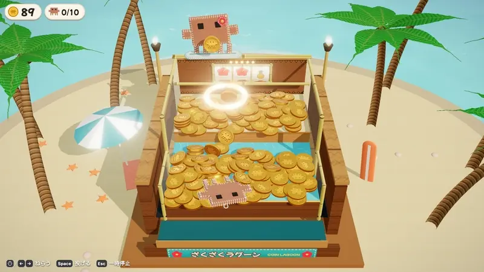
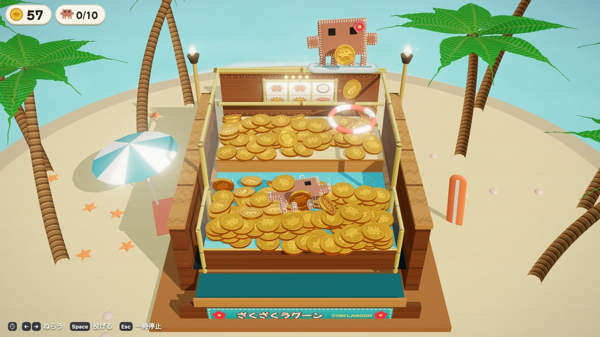
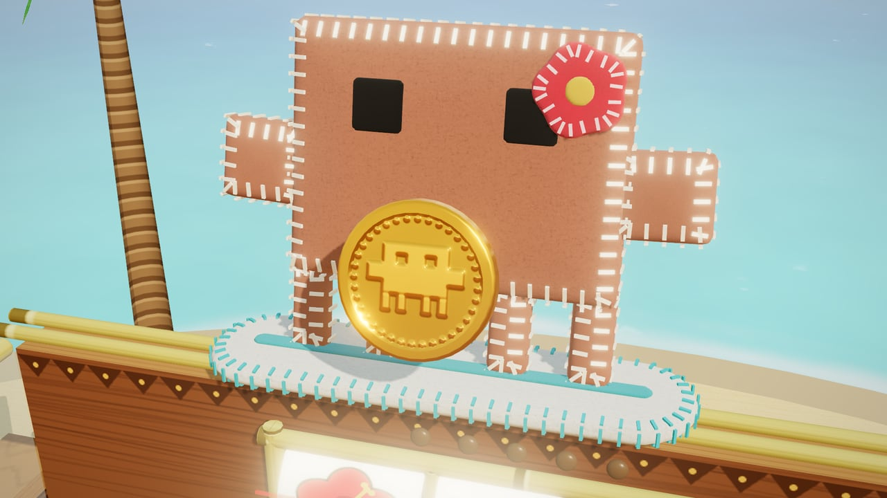
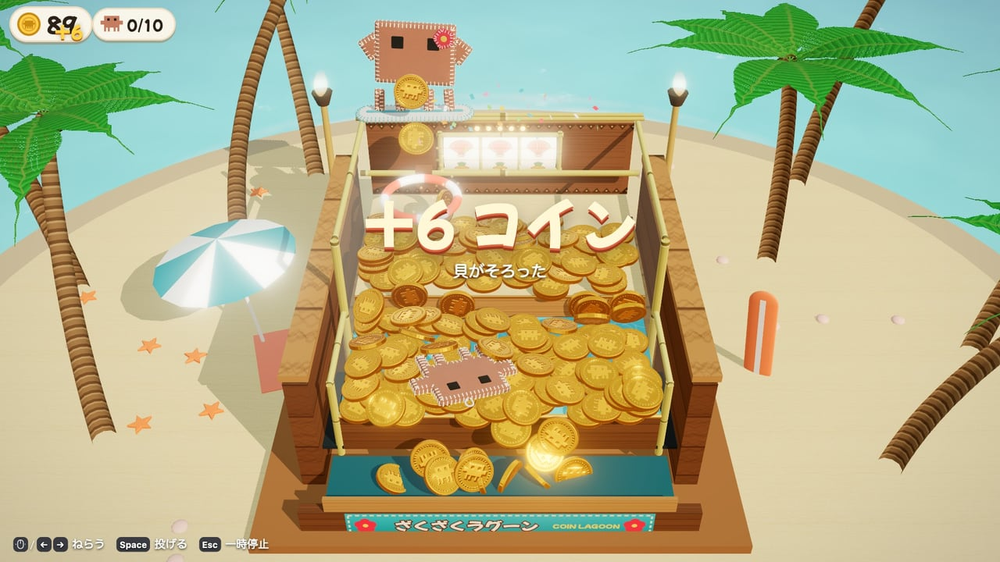
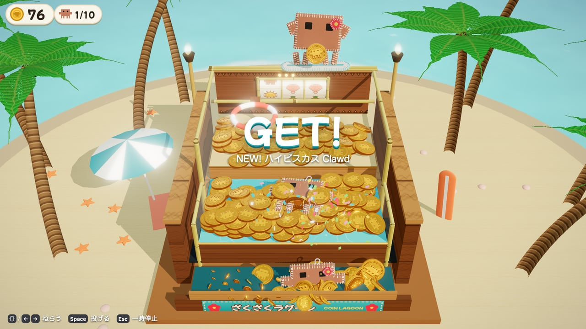
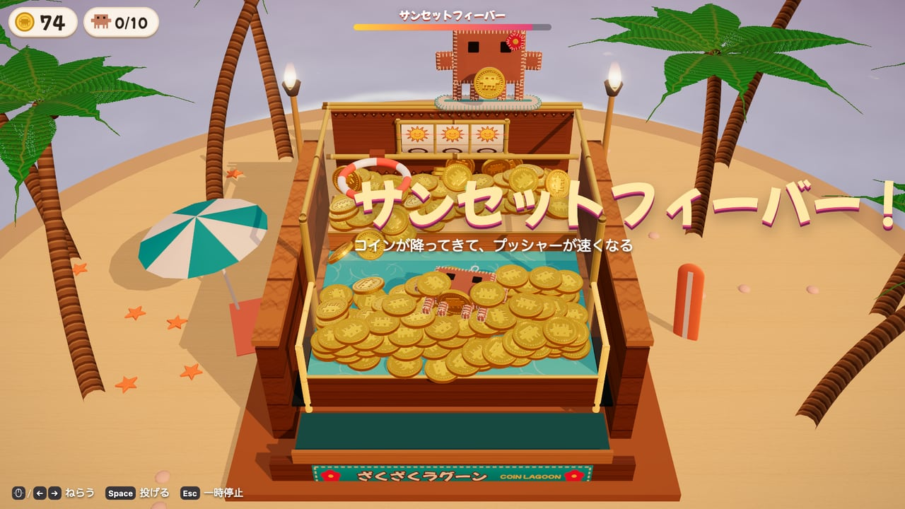
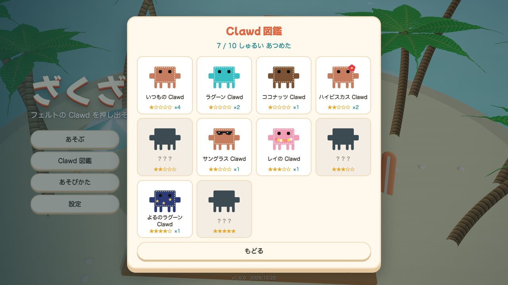

# ざくざくラグーン — Coin Lagoon

南の島の浜辺に置かれた、フェルトの Clawd を押し出して集める 3D コインプッシャー。

[](https://tanuu5.github.io/coin-lagoon/)
[](https://www.anthropic.com/claude)
[](./LICENSE)
[](#english)

<p align="center">
  
</p>

<p align="center"><b><a href="https://tanuu5.github.io/coin-lagoon/">▶ ブラウザで今すぐ遊ぶ</a></b>（PC・スマホ対応、インストール不要）</p>

**Claude Code × Claude Opus 5.5（MAX）** で作りました。

ヤシの木とラグーンに囲まれた浜辺のコインプッシャーです。フェルトでできた大きな Clawd がサーフボードで左右に動き、コインを投げてくれます。コインが浮き輪をくぐるとスロットが回り、プッシャーに押されて手前から落ちたコインがもらえます。台の上のフェルトの Clawd（全 10 種）を押し出して、図鑑を埋めましょう。
形・模様・曲・効果音は、画像や音声のファイルを使わず、すべてコードで作っています。日本語と英語に対応しています（設定で切り替え）。English follows below.

> [!NOTE]
> 非公式のファンメイド作品です。Clawd は Anthropic の Claude Code のマスコットで、この作品は Anthropic とは関係ありません。

## スクリーンショット

<table>
  <tr>
    <td width="50%"><br><sub>奥の壁の上から Clawd がコインを投げる。浮き輪をくぐればスロットが回る。</sub></td>
    <td width="50%"><br><sub>Clawd は薄いフェルトのぬいぐるみ。ふちのステッチも、抱えたコインの浮き彫りもコードで作った。</sub></td>
  </tr>
  <tr>
    <td><br><sub>スロットで貝がそろって +6 コイン。払い出しは手前の受け皿へ。</sub></td>
    <td><br><sub>フェルトの Clawd を押し出すと GET!　はじめての種類は NEW! と出る。</sub></td>
  </tr>
  <tr>
    <td><br><sub>太陽が 3 つそろうとサンセットフィーバー。空が夕焼けになり、コインが降ってくる。</sub></td>
    <td><br><sub>集めた Clawd は図鑑に並ぶ。いちばん出にくいのは、きんいろ Clawd。</sub></td>
  </tr>
</table>

画像と動画は、すべて実際のゲーム画面です。

## 遊び方

| 操作 | マウス | キーボード | ゲームパッド | タッチ |
| --- | --- | --- | --- | --- |
| ねらう（左右） | 動かす | ← → / A D | 左スティック / 十字キー | 投げたい所をタップ |
| 投げる | クリック（押したままで続けて） | Space / J / ↓ / S | A / RB / RT | タップ（押したまま指を動かすと続けて） |
| 一時停止 | — | Esc / P | Start | 右上の Ⅱ |

- **コイン**：プッシャー（前後に動く台）に押されて、手前のふちから落ちたコインがもらえます。
- **横のガード**：はじめは「あり」で、横には落ちません。設定で「なし」にすると、本物のプッシャーのように横からも落ちます（横に落ちたコインはなくなります）。
- **浮き輪とスロット**：コインが浮き輪をくぐるとスロットが回ります（5 回までためられます）。

  | そろった絵 | もらえるもの |
  | --- | --- |
  | ハイビスカス | コイン 2 枚 |
  | ココナッツ | コイン 4 枚 |
  | 貝 | コイン 6 枚 |
  | パイナップル | コイン 10 枚 |
  | Clawd | フェルトの Clawd が 1 つ降ってくる（＋コイン 2 枚） |
  | 太陽 | サンセットフィーバー（25 秒）：コインの雨、プッシャーが速くなる、横のガードが上がる |

- **フェルトの Clawd**：手前から落とすと図鑑に入ります（全 10 種、出やすさは星の数）。台に 1 つもなくなると、少しして新しい Clawd が降ってきます。
- **おこづかい**：コインが 5 枚より少ないと、6 秒ごとに 1 枚もらえます（10 枚まで）。
- 台の上のコインの並び・持っているコイン・図鑑は、ブラウザ（localStorage）に保存されます。設定の「データを消して、はじめから」で消せます。

## 制作について

企画・ディレクション：**たぬ**　／　開発：**Claude Code（Claude Opus 5.5・推論レベル MAX）**

たぬの企画をもとに、ルールの設計から 3D の表示、物理、曲と効果音、画面までを Claude Code が実装しました。フェルトの Clawd は、2 枚の布をふちで縫い合わせて少しだけ綿を入れた形を距離関数から作り、ふちのブランケットステッチもコードで並べています。コインの物理は Rapier で計算し、描画なしで台を動かす調整用のスクリプトで、横に落ちる割合・戻り・浮き輪の当たりやすさを数えて台の寸法を決めました。見た目はヘッドレス Chrome（実 GPU）で撮って確かめています。

## 更新履歴

- **2026-10-23**：公開

## 開発

```bash
npm install
npm run dev      # 開発サーバー（http://127.0.0.1:5188/）
npm run build    # dist/ に公開用のファイル
```

- URL のパラメータ：`?lang=en`（英語）、`?quality=high`（画質を固定）、`?mute`（音なし）、`?dev`（公開版でも確認用の `window.__dev` を出す）
- `node tools/sim.mjs --play 120 --rate 3 --aim random` で、描画なしに台を動かして、戻り・横に落ちる割合・浮き輪の当たりやすさを数えられます（`--write` ではじめの台を作り直す）。
- 確認台：開発サーバーで `/dev/viewer.html?m=clawd`（大きな Clawd）、`?m=prize`（景品 10 種）。

| ファイル | 中身 |
| --- | --- |
| `src/game/Game.js` | 状態（タイトル・遊ぶ・一時停止）、投げる操作、スロット・フィーバー・景品・おこづかい・保存 |
| `src/game/machine/` | 台の寸法（`layout.js`）と物理（`Physics.js`、Rapier）、はじめの台 |
| `src/game/view/` | コイン、台、景色、浮き輪、リール、紙ふぶき、フェルト（`Felt.js`）と Clawd（`ClawdFelt.js`） |
| `src/game/Slot.js` / `prizes.js` | スロットの絵と当たり、景品の種類と出やすさ |
| `src/audio/` | Web Audio で合成する楽器・効果音・曲・波の音 |
| `src/ui/` | HUD、図鑑、画面、タッチ操作 |

## GitHub Pages で公開する

`main` に push すると、`.github/workflows/deploy.yml` がビルドして GitHub Pages に公開します。初回だけ、リポジトリの Settings → Pages → Source を「GitHub Actions」にします。

## クレジット・ライセンス

- コード：MIT License（[LICENSE](LICENSE)）© 2026 たぬ
- **Clawd について**：Clawd は Anthropic の Claude Code のマスコットです。この作品のフェルトの Clawd は、公式アセットを使わずにコードで描き起こした二次創作（ファンアート）です。Clawd のキャラクターは MIT License の対象外で、名称とキャラクターの権利は Anthropic に帰属します。
- 3D 描画：[three.js](https://threejs.org/)（MIT License）
- 物理エンジン：[Rapier](https://rapier.rs/)（`@dimforge/rapier3d-compat`、Apache License 2.0。ビルドしたファイルに含まれます）
- フォント：[Mochiy Pop One](https://fonts.google.com/specimen/Mochiy+Pop+One)（Google Fonts から読み込み、SIL Open Font License）
- MIT License の対象はこのリポジトリのコードと文章です。「Claude」の名前や商標の使用を許諾するものではありません。

---

## English

**▶ Play in your browser (PC and smartphones, no install): https://tanuu5.github.io/coin-lagoon/**

A 3D coin pusher on a tropical beach, made with **Claude Code × Claude Opus 5.5 (MAX)**. A big felt Clawd rides a surfboard along the back wall and tosses coins for you; push the felt Clawd prizes off the front edge to fill your collection book. Switch the language to English in Settings (or open the page with `?lang=en`).

- Clawd is a thin, lightly stuffed felt plush with blanket stitches and four legs — all modeled in code
- Toss a coin through the swim ring to spin the slot; three suns start the Sunset Fever (coin rain, faster pusher)
- 10 kinds of felt Clawd to collect, from Classic to the rare Golden Clawd
- Side guards are on by default (nothing falls off the sides); turn them off in Settings for a real-pusher challenge
- No image or audio files: textures, music and sound effects are all generated in code

Controls: move the mouse or `←` `→` to aim · click / `Space` to toss (hold to keep tossing) · `Esc` pause. Gamepads and touch work too.

This is an unofficial fan project; Clawd is the mascot of Anthropic's Claude Code. Code is released under the MIT License (the Clawd character is not covered). Built with three.js (MIT) and Rapier (Apache-2.0).
